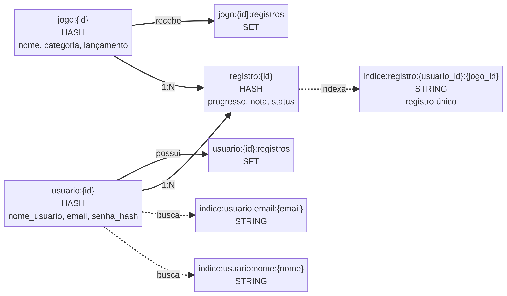

# Checkpoint 🎮

**Seu diário de jogos.** Registre o que você jogou, acompanhe seu progresso,
dê uma nota e escreva o que achou. Quanto mais você usa, mais XP ganha e mais
sobe no ranking.

Projeto acadêmico de backend com **Django**, **Django REST Framework** e
**Redis** como banco principal, sem ORM.

## Como funciona

1. **Você cadastra um jogo** no seu catálogo (ex.: Zelda, categoria RPG).
2. **Você cria um registro** dele, com progresso, tempo jogado, nota e avaliação.
3. **Você ganha XP** a cada atividade e disputa o ranking.

Seu catálogo é só seu: nenhum outro usuário vê seus jogos, nem o admin.

## Modelagem dos dados



O modelo tem três entidades. O **Usuário** realiza **Registros**, e cada
**Registro** liga o usuário a um **Jogo**. O Registro guarda o que é pessoal:
progresso, tempo jogado, data de conclusão e nota. Um usuário só pode ter um
registro por jogo.

No Redis, cada entidade é um Hash (`usuario:{id}`, `jogo:{id}`,
`registro:{id}`), e o XP fica em um Sorted Set (`ranking:xp`).

## Começando

**Você precisa de:** Python 3.11+ e Docker.

```bash
git clone [https://github.com/DevTroli/CheckPoint.git](https://github.com/DevTroli/CheckPoint.git)
cd CheckPoint
python -m venv .venv && source .venv/bin/activate
pip install -e '.[dev]'

docker compose up -d redis      # sobe o banco
python manage.py runserver      # sobe a API
```

Pronto: a API está em `http://127.0.0.1:8000`.

Para configurar o Redis, use as variáveis de ambiente (os valores abaixo são
os padrões locais):

```bash
REDIS_HOST=localhost
REDIS_PORT=6379
REDIS_DB=0
REDIS_PASSWORD=
DJANGO_SECRET_KEY=uma-chave-local
```

## Tutorial: do zero ao ranking

Os exemplos usam `curl`. O arquivo `cookies.txt` guarda sua sessão de login.

### 1. Crie sua conta

O primeiro usuário cadastrado vira **admin**.

```bash
curl -c cookies.txt -X POST http://127.0.0.1:8000/api/usuarios/ \
  -H 'Content-Type: application/json' \
  -d '{"nome_usuario":"ana","email":"ana@example.com","senha":"senha123"}'
```

### 2. Faça login

```bash
curl -b cookies.txt -c cookies.txt -X POST http://127.0.0.1:8000/api/auth/login/ \
  -H 'Content-Type: application/json' \
  -d '{"email":"ana@example.com","senha":"senha123"}'
```

### 3. Cadastre um jogo

```bash
curl -b cookies.txt -X POST http://127.0.0.1:8000/api/jogos/ \
  -H 'Content-Type: application/json' \
  -d '{"nome":"Zelda","categoria":"RPG"}'
```

O nome do jogo é único por usuário. Para achar jogos depois, use
`/api/jogos/?busca=zelda`, `?categoria=RPG` ou `?ordenar=nome`.

### 4. Registre seu progresso

Crie um registro para o jogo (`POST /api/registros/`) com progresso, tempo
jogado, nota, status e avaliação. Para atualizar depois, use
`PATCH /api/registros/{id}/`.

### 5. Veja seu XP e o ranking

```bash
curl -b cookies.txt http://127.0.0.1:8000/api/gamificacao/me/
curl -b cookies.txt "http://127.0.0.1:8000/api/gamificacao/ranking/?limite=10"
```

| Ação | XP |
|---|---|
| Criar um registro | 25 |
| Atualizar um registro | 5 |
| Primeira atividade do dia | 5 |

Dias seguidos de atividade aumentam seu **streak**. A mesma atividade não
conta XP duas vezes no mesmo dia. O ranking é público, mas mostra só o
`nome_usuario`, nunca o e-mail.

## Todas as rotas

| Grupo | Rotas |
|---|---|
| Conta | `POST /api/usuarios/` · `POST /api/auth/login/` · `POST /api/auth/logout/` · `GET/PATCH /api/usuarios/me/` |
| Jogos | `GET/POST /api/jogos/` · `GET/PUT/DELETE /api/jogos/{id}/` |
| Registros | `GET/POST /api/registros/` · `GET/PATCH/DELETE /api/registros/{id}/` |
| Gamificação | `GET /api/gamificacao/me/` · `GET /api/gamificacao/ranking/` |

Todas as rotas, exceto o cadastro e o login, exigem login.

## Testes

```bash
python manage.py check
pytest -q
```

Os testes usam `fakeredis`, então não precisam de servidor Redis. Eles cobrem
CRUD, autenticação, permissões, XP, ranking e streak.

## Estrutura

```text
app/
├── api/            # views, serializers, rotas e gamificação
└── persistencia/   # conexão, chaves e repositórios Redis
config/             # settings e urls do Django
tests/              # testes de API e repositórios
```

## Status

- ✅ Banco de dados (Redis)
- ✅ Backend (API)
- ✅ Frontend
